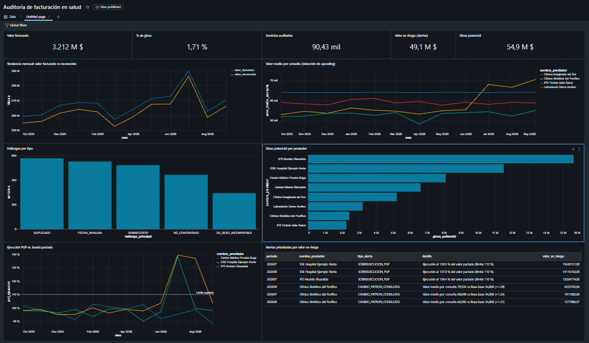
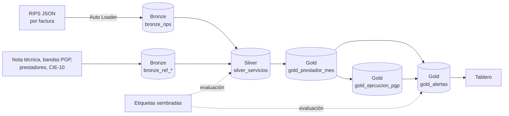
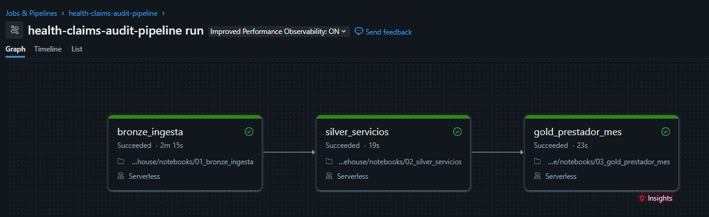

# Auditoría de facturación en salud — Lakehouse con Databricks

[](https://github.com/samvie1232/health-claims-audit-lakehouse/actions/workflows/ci.yml)   

🇬🇧 [English version](README.md)

Pipeline end-to-end que audita la facturación de prestadores de salud (RIPS en JSON, Resolución 2275 de 2023) contra la nota técnica contractual, detecta sobrecostos y facturación atípica, y prioriza el riesgo por prestador y mes.

> Todos los datos son **100 % sintéticos** (`scripts/generar_rips_sinteticos.py`, semilla fija). Ningún dato proviene de una EPS, IPS o persona real.

## Resultados (12 meses: oct 2025 – sep 2026)



| Métrica | Valor |
| --- | --- |
| Facturas RIPS procesadas | 10.101 |
| Servicios auditados | 90.430 |
| Valor facturado | $3.212 millones COP |
| Glosa potencial identificada | **$54,9 millones COP** (1,7 %) |
| Servicios con hallazgo | 2.385 (2,6 %) |
| Valor en riesgo en alertas prestador-mes | **$49,1 millones COP** (6 alertas) |
| Reglas por servicio — precisión / recall | 100 % / 99,96 % |
| Alertas prestador-mes — precisión / recall | 100 % / 100 % |

Las métricas de precisión y recall se calculan contra anomalías **sembradas y etiquetadas** por el generador, que nunca se usan para construir las reglas.

## Problema

Una EPS recibe cada mes miles de facturas con sus RIPS. Auditarlas a mano contra lo pactado en cada contrato (evento, PGP, cápita) es lento y deja pasar dos tipos de problemas:

1. **Errores por servicio**: cobros por encima de la tarifa, servicios no contratados, duplicados, fechas imposibles, diagnósticos incompatibles.
2. **Patrones que ninguna fila revela**: un contrato PGP que se sale de su banda, o un prestador que empieza a facturar sistemáticamente las consultas más caras (*upcoding*) aunque cada una cobre la tarifa correcta.

## Arquitectura



| Capa | Notebook | Qué hace |
| --- | --- | --- |
| Setup | `00_setup` | Crea esquema y volúmenes en Unity Catalog, genera los datos |
| Bronze | `01_bronze_ingesta` | Ingesta incremental de JSON con Auto Loader + tablas de referencia |
| Silver | `02_silver_servicios` | Aplana factura → usuario → servicio, aplica 5 reglas de auditoría, valoriza contra la NT |
| Gold | `03_gold_prestador_mes` | Agregados por prestador-mes, ejecución PGP vs. bandas, alertas de patrón |

## Reglas y alertas

**Por servicio (Silver)**

| Regla | Detecta |
| --- | --- |
| `DUPLICADO` | Mismo prestador, usuario, tecnología, fecha y valor facturado más de una vez |
| `NO_CONTRATADO` | Tecnología fuera de la nota técnica del prestador (`NT_NO_CRUZA`) |
| `SOBRECOSTO` | Valor unitario por encima de la tarifa pactada (tolerancia 5 %) |
| `FECHA_INVALIDA` | Atención antes del nacimiento, en el futuro o ilegible |
| `DX_SEXO_INCOMPATIBLE` | Diagnóstico restringido a un sexo distinto al del usuario |

**Por prestador-mes (Gold)**

| Alerta | Detecta | Valor en riesgo |
| --- | --- | --- |
| `SOBREEJECUCION_PGP` | Ejecución mensual por encima del límite superior de la banda (110 %) | Exceso sobre el límite |
| `CAMBIO_PATRON_CONSULTAS` | Valor medio por consulta > 1,2 × la mediana de sus 6 meses previos | Diferencia × consultas |

## Decisiones de diseño

- **Silver marca, no elimina.** En auditoría el hallazgo es el producto; cada servicio conserva sus banderas `dq_*`.
- **Valorización con la lógica real del negocio:** `VALORIZADO_SEGUN_NT` / `NT_NO_CRUZA`, valor reconocido = cantidad × mín(facturado, tarifa NT).
- **Evaluación separada de la construcción:** las etiquetas viven en tablas `eval_*` y solo se usan para medir.
- **Reproducible:** semilla fija; cualquiera obtiene los mismos datos y resultados.

## Limitaciones conocidas

- Las reglas detectan casi el 100 % porque las anomalías por servicio se sembraron con patrones detectables por regla. En datos reales, la precisión dependerá de la calidad de la nota técnica.
- El único falso negativo es un sobrecosto en un medicamento de muy bajo valor que, por redondeo, cae dentro de la tolerancia del 5 %.
- La alerta de patrón usa una línea base histórica: si el prestador sigue inflando, su línea base se contamina y la señal se debilita mes a mes (de ×1,29 a ×1,21 en los datos actuales).

## Cómo ejecutarlo

1. Crea una cuenta en [Databricks Free Edition](https://www.databricks.com/learn/free-edition).
2. **Workspace → Create → Git folder** con la URL de este repo.
3. Ejecuta una vez `notebooks/00_setup` para crear el esquema y generar los datos.
4. Ejecuta el job `health-claims-audit-pipeline` (o los notebooks `01` → `02` → `03` en orden) sobre cómputo Serverless.

## Pruebas y CI

Las reglas de auditoría viven en un paquete Python (`src/health_audit`) como funciones puras sobre DataFrames. Los notebooks solo leen y escriben tablas, así que **la misma lógica corre en Databricks y en Spark local**. GitHub Actions ejecuta `ruff` y **26 tests de pytest** sobre PySpark 4 en cada push y pull request:

| Archivo | Qué valida |
| --- | --- |
| `test_silver_reglas.py` | Cada una de las 5 reglas con casos límite hechos a mano: la frontera de la tolerancia del 5 % (105,00 vs. 105,01), duplicados (solo se marca la repetición y no se paga), fechas antes del nacimiento o futuras, diagnósticos restringidos por sexo, prioridad de reglas y que Silver marca pero nunca elimina filas. |
| `test_gold.py` | Estados de la banda PGP y exceso sobre el límite; la alerta de patrón dispara por encima de 1,2×, no por debajo, y solo con al menos 3 meses de historia. |
| `test_pipeline.py` | De punta a punta sobre 12 meses sintéticos (generador → Bronze → Silver → Gold): una fila por servicio, llave única, valor reconocido nunca mayor a lo facturado, reglas con precisión ≥99,9 % y recall ≥99,5 %, alertas prestador-mes al 100 %/100 % y generador reproducible (misma semilla, mismos archivos). |

Los tests se validaron con *mutation testing*: cinco errores introducidos a propósito en las reglas (`>=` en vez de `>` en la tolerancia, pagar duplicados, reconocer lo facturado en vez de la tarifa, quitar el control de fechas futuras, exigir 1 mes de historia en la alerta de patrón) hicieron fallar la suite.

```bash
pip install -e ".[dev]"      # requiere Java 17+
ruff check . && pytest
```

## Orquestación

Un Lakeflow Job encadena las capas con dependencias: `bronze_ingesta` → `silver_servicios` → `gold_prestador_mes`, sobre cómputo Serverless. Si una capa falla, las siguientes no se ejecutan.



## Stack

Databricks Free Edition · PySpark · Delta Lake · Unity Catalog · Auto Loader · Lakeflow Jobs · Databricks AI/BI Dashboards · Git Folders

## Hoja de ruta

- [x] Generador de datos sintéticos con anomalías etiquetadas
- [x] Bronze: ingesta incremental de JSON
- [x] Silver: aplanado, calidad y valorización contra NT
- [x] Gold: métricas por prestador, ejecución PGP y alertas de patrón
- [x] Evaluación de reglas y alertas contra etiquetas
- [x] Tablero en Databricks AI/BI (`dashboards/consultas_tablero.sql`)
- [x] Orquestación con Lakeflow Jobs
- [x] CI con GitHub Actions: ruff + pytest sobre Spark local
- [ ] CD con Databricks Asset Bundles
