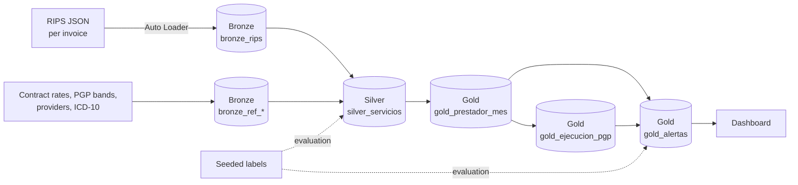

# Healthcare Claims Audit — Databricks Lakehouse

[](https://github.com/samvie1232/health-claims-audit-lakehouse/actions/workflows/ci.yml)   

🇪🇸 [Versión en español](README.es.md)

End-to-end pipeline that audits healthcare provider billing (Colombian RIPS claims in JSON, Resolution 2275/2023) against contracted rates, flags overbilling and anomalous billing patterns, and ranks financial risk by provider and month.

> All data is **100% synthetic** (`scripts/generar_rips_sinteticos.py`, fixed seed). No data comes from a real insurer, provider or person.

## Results (12 months: Oct 2025 – Sep 2026)


| Metric | Value |
| --- | --- |
| RIPS invoices processed | 10,101 |
| Services audited | 90,430 |
| Billed amount | COP 3,212 million |
| Potential claim denials identified | **COP 54.9 million** (1.7%) |
| Services with findings | 2,385 (2.6%) |
| Value at risk in provider-month alerts | **COP 49.1 million** (6 alerts) |
| Service-level rules — precision / recall | 100% / 99.96% |
| Provider-month alerts — precision / recall | 100% / 100% |

Precision and recall are measured against anomalies **seeded and labeled** by the generator. Labels are never used to build the rules.

## Problem

A health insurer (EPS) receives thousands of invoices with their RIPS every month. Auditing them manually against each contract (fee-for-service, PGP global budget, capitation) is slow and misses two kinds of issues:

1. **Service-level errors**: charges above the contracted rate, non-contracted services, duplicates, impossible dates, sex-incompatible diagnoses.
2. **Patterns no single row reveals**: a PGP contract exceeding its monthly band, or a provider that starts systematically billing the most expensive consultation codes (*upcoding*) even though each one is priced correctly.

## Architecture



| Layer | Notebook | What it does |
| --- | --- | --- |
| Setup | `00_setup` | Creates schema and volumes in Unity Catalog, generates the data |
| Bronze | `01_bronze_ingesta` | Incremental JSON ingestion with Auto Loader + reference tables |
| Silver | `02_silver_servicios` | Flattens invoice → patient → service, applies 5 audit rules, values each service against the contract (logic in `src/health_audit/silver.py`) |
| Gold | `03_gold_prestador_mes` | Provider-month aggregates, PGP execution vs. bands, pattern alerts (logic in `src/health_audit/gold.py`) |

## Rules and alerts

**Service level (Silver)**

| Rule | Detects |
| --- | --- |
| `DUPLICADO` | Same provider, patient, code, date and amount billed more than once |
| `NO_CONTRATADO` | Code not in the provider's contract (`NT_NO_CRUZA`) |
| `SOBRECOSTO` | Unit price above the contracted rate (5% tolerance) |
| `FECHA_INVALIDA` | Service before birth, in the future, or unreadable |
| `DX_SEXO_INCOMPATIBLE` | Diagnosis restricted to the other sex |

**Provider-month level (Gold)**

| Alert | Detects | Value at risk |
| --- | --- | --- |
| `SOBREEJECUCION_PGP` | Monthly execution above the band's upper limit (110%) | Excess over the limit |
| `CAMBIO_PATRON_CONSULTAS` | Average consultation price > 1.2 × median of the provider's previous 6 months | Difference × consultations |

## Design decisions

- **Silver flags, it does not drop.** In auditing, the finding is the product; every service keeps its `dq_*` flags.
- **Real business valuation logic:** `VALORIZADO_SEGUN_NT` / `NT_NO_CRUZA`; recognized value = quantity × min(billed, contracted rate).
- **Evaluation separated from construction:** labels live in `eval_*` tables and are used only to measure.
- **Reproducible:** fixed seed; anyone gets the same data and results.

## Known limitations

- Rules reach ~100% because service-level anomalies were seeded with rule-detectable patterns. On real data, precision depends on the quality of the contract rates.
- The only false negative is overbilling on a very low-cost drug that, after rounding, falls inside the 5% tolerance.
- The pattern alert uses a historical baseline: if a provider keeps inflating, its baseline gets contaminated and the signal weakens month after month (from ×1.29 to ×1.21 in the current data).

## How to run it

1. Create a [Databricks Free Edition](https://www.databricks.com/learn/free-edition) account.
2. **Workspace → Create → Git folder** with this repo's URL.
3. Run `notebooks/00_setup` once to create the schema and generate the data.
4. Run the `health-claims-audit-pipeline` job (or notebooks `01` → `02` → `03` in order) on Serverless compute.

## Tests and CI

The audit rules live in a Python package (`src/health_audit`) as pure functions over DataFrames. The notebooks only read and write tables, so **the exact same logic runs in Databricks and in local Spark**. GitHub Actions runs `ruff` and **26 pytest tests** on PySpark 4 on every push and pull request:

| Test file | What it checks |
| --- | --- |
| `test_silver_reglas.py` | Each of the 5 rules with hand-built edge cases: the 5% overbilling tolerance boundary (105.00 vs 105.01), duplicates (only the repeat is flagged and it is not paid), dates before birth or in the future, sex-restricted diagnoses, rule priority, and that Silver flags but never drops rows. |
| `test_gold.py` | PGP band states and excess over the upper limit; the pattern alert fires above the 1.2× threshold, not below it, and only with at least 3 months of history. |
| `test_pipeline.py` | End to end on 12 months of synthetic data (generator → Bronze → Silver → Gold): one row per service, unique service key, recognized value never above billed value, service rules at ≥99.9% precision and ≥99.5% recall, provider-month alerts at 100%/100%, and a reproducible generator (same seed, identical files). |

The tests were mutation-checked: five deliberate bugs in the rules (`>=` instead of `>` on the tolerance, paying duplicates, paying the billed instead of the contracted price, dropping the future-date check, a 1-month history for the pattern alert) each made the suite fail.

```bash
pip install -e ".[dev]"      # needs Java 17+
ruff check . && pytest
```

## Orchestration

A Lakeflow Job chains the layers with dependencies: `bronze_ingesta` → `silver_servicios` → `gold_prestador_mes`, on Serverless compute. If a layer fails, downstream layers do not run.


## Stack

Databricks Free Edition · PySpark · Delta Lake · pytest · GitHub Actions · Unity Catalog · Auto Loader · Lakeflow Jobs · Databricks AI/BI Dashboards · Git Folders

## Roadmap

- [x] Synthetic data generator with labeled anomalies
- [x] Bronze: incremental JSON ingestion
- [x] Silver: flattening, data quality and contract valuation
- [x] Gold: provider metrics, PGP execution and pattern alerts
- [x] Evaluation of rules and alerts against labels
- [x] Databricks AI/BI dashboard (`dashboards/consultas_tablero.sql`)
- [x] Orchestration with Lakeflow Jobs
- [x] CI with GitHub Actions: ruff + pytest on local Spark
- [ ] CD with Databricks Asset Bundles
